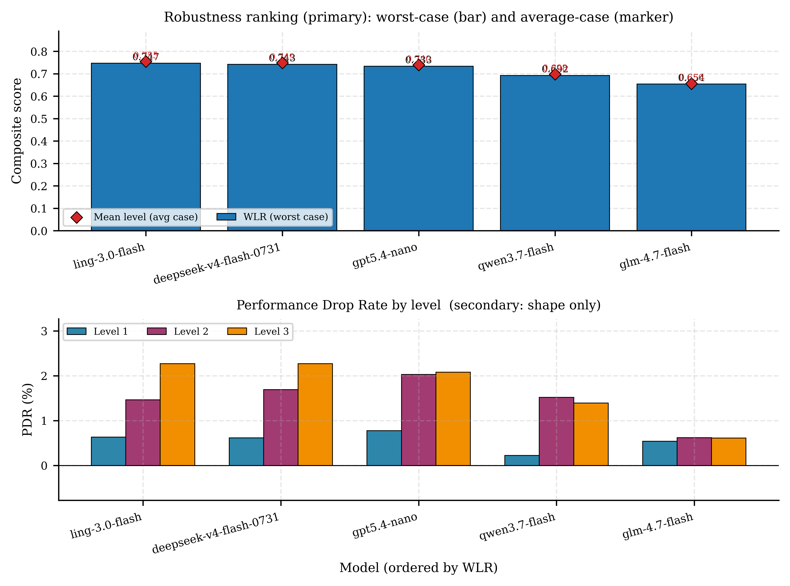

# ROBIN: Robust Instruction Benchmark for Indonesian Noise

[](https://www.python.org/downloads/)
[](https://opensource.org/licenses/Apache-2.0)
[](https://huggingface.co/datasets/nicovalerian/robin-benchmark)

ROBIN tests how well language models follow instructions written in Indonesian-English code-mixed text.

Most instruction-following benchmarks use clean, single-language prompts. Real users often mix languages, especially in urban Indonesia. ROBIN takes 750 Indonesian instructions, adds three checkable constraints to each one, and rewrites every instruction four ways: one formal Indonesian version and three increasingly code-mixed ones. That gives 3,000 prompts. In the paper we ran five models on all of them, for 15,000 responses in total.

Each response gets two scores. The first checks whether it met the constraints (keyword, length, format). The second compares it to a reference answer using ROUGE-L and an IndoBERT-based BERTScore. Models are ranked by Worst-Level Robustness (WLR), their lowest average score across the four versions. We also report Performance Drop Rate (PDR), but only as a side diagnostic.

## Getting the data

Everything is on Hugging Face at [`nicovalerian/robin-benchmark`](https://huggingface.co/datasets/nicovalerian/robin-benchmark):

```python
from datasets import load_dataset

robin = load_dataset("nicovalerian/robin-benchmark", "benchmark", split="test")     # 750 instructions
outputs = load_dataset("nicovalerian/robin-benchmark", "inference", split="test")   # 15,000 model responses
scores = load_dataset("nicovalerian/robin-benchmark", "evaluation", split="test")   # 15,000 scored responses
```

The benchmark file is also in this repo at `data/processed/robin_dataset.jsonl`. Its SHA-256 is `66c584aecef676eec029d448674177315c392ffe35ba8bcbcdf72dc5d84b8720`. The paper's analysis outputs and figures are in `results/robin_final/`.

## Results

These are the numbers from the paper (Tables 2 and 3). S0 is the score on formal Indonesian, Mean-Lvl is the average over all four versions, and PDR-R is the PDR-based score.

| Model | S0 | WLR | Mean-Lvl | PDR-R |
|-------|----|-----|----------|-------|
| Ling 3.0 Flash | 0.7618 | **0.7470** | 0.7551 | 98.54 |
| DeepSeek V4 Flash 0731 | 0.7554 | 0.7425 | 0.7485 | 98.48 |
| GPT-5.4 Nano | 0.7462 | 0.7333 | 0.7397 | 98.37 |
| Qwen 3.7 Flash | 0.7021 | 0.6923 | 0.6982 | 98.96 |
| GLM 4.7 Flash | 0.6568 | 0.6544 | 0.6560 | 99.41 |

Constraint pass rates per type:

| Model | Keyword | Length | Format |
|-------|---------|--------|--------|
| Ling 3.0 Flash | 0.9643 | 0.8450 | 0.9857 |
| DeepSeek V4 Flash 0731 | 0.9830 | 0.8157 | 0.9950 |
| GPT-5.4 Nano | 0.9543 | 0.7500 | 0.9937 |
| Qwen 3.7 Flash | 0.9397 | 0.7073 | 0.9157 |
| GLM 4.7 Flash | 0.8990 | 0.5377 | 0.9240 |

A few things stand out:

- Ling scores highest, but its lead over DeepSeek (0.0045) is within noise. The paired bootstrap 95% CI is [-0.0036, 0.0135].
- Length is the hardest constraint for every model.
- GLM has the best PDR score and the worst WLR. Its scores barely move between versions because they start low. That's why we don't rank on PDR.



## The four versions

All rewrites and reference answers were generated by `gpt-5.6-luna`. Temperature was left unset because the endpoint rejects 0, and output was capped at 2,048 tokens. The three constraint lines are copied unchanged onto the end of every version, and all 2,250 code-mixed prompts keep them exactly. The prompt templates are in `configs/perturbation_prompts.yaml`, and the paper's appendix reproduces them.

| Level | Name | What changes |
|-------|------|--------------|
| L0 | Formal Indonesian | Nothing. This is the control. |
| L1 | Lexical borrowing | A few Indonesian nouns become English (`teks` to `text`, `daftar` to `list`). In 8 items there was nothing to swap, so L1 equals L0. |
| L2 | Morphological fusion | An Indonesian prefix goes on an English verb (`me-`, `di-` or `nge-`), plus one English filler such as `actually`, `by the way`, `I mean`, `literally` or `basically`. |
| L3 | Intra-sentential switching | One clause switches to English, one English word is respelled the Indonesian way (`rait`, `rili`, `litereli`, `greit`, `plis`), and an Indonesian word gets an English suffix (`-ly` in 461 items, `-ness` in 289). |

After generation, a seeded script tries to add some colloquial touches. At L2 it adds a discourse particle 65% of the time when none is present. At L3 it applies IndoCollex word swaps (45% per mapping), adds particles (80%) and lowercases some sentence starts (25%). Restoring the constraint lines undoes most of this, so only 15 L2 and 21 L3 prompts end up with a particle.

The features come from published descriptions of South Jakarta ("Jaksel") speech (Wijaya & Bram 2021; Budiarti & Faris 2023; Suswandi 2022; Wibowo et al. 2021). They're synthetic, though, and nobody has checked them against how people actually talk. Think of ROBIN as a controlled stress test, not a sample of real Jaksel.

### Example

`robin_00137` (creative writing), copied exactly from the dataset. Every version ends with the same three lines: *Pastikan jawaban mengandung kata: virusnya, dokter. / Jawab dalam 6-24 kata. / Gunakan format poin-poin.*

| Level | Instruction |
|-------|-------------|
| L0 | Sampaikan sebuah lelucon mengenai komputer. |
| L1 | Sampaikan sebuah lelucon mengenai computer. |
| L2 | Nge-share sebuah lelucon mengenai komputer, I mean, satu lelucon. |
| L3 | Topik komputer, litereli luculy, tell a joke about computers. |

## Quick start

### Install

```bash
git clone https://github.com/nicovalerian/robin-benchmark.git
cd robin-benchmark

python -m venv venv
venv\Scripts\activate      # Windows
# source venv/bin/activate # Linux/Mac

pip install -r requirements.txt
```

You need Python 3.10 or newer. We developed it on 3.13.

### API keys

```bash
cp .env.example .env
```

```env
OPENROUTER_API_KEY=...   # for running the models (Phase 2)
ELICE_API_KEY=...        # only if you want to regenerate the dataset with gpt-5.6-luna
```

### Reproducing the paper

Use the committed dataset. Don't re-run Phase 1, since the rewrites are LLM-generated and won't come out the same twice. Run Phases 2 to 4 with the paper's OpenRouter config:

```bash
python scripts/run_phase2.py --config configs/openrouter_phase2.yaml --output data/output/inference_results.jsonl
python scripts/run_phase3.py --input data/output/inference_results.jsonl --output data/output/evaluation_results.jsonl
python scripts/run_phase4.py --input data/output/evaluation_results.jsonl --output results/ --visualize
```

To skip the API calls, download our outputs from Hugging Face. Feed `results/robin_phase2_final_15000.jsonl` to Phase 3, or `results/robin_phase3_final_15000.jsonl` straight to Phase 4.

Some requests failed during the paper run and were retried with `scripts/retry_failed_phase2.py`. There were 118 DeepSeek cells (`configs/deepseek_retry.yaml`, `retry_keys/deepseek_failed_118.jsonl`) and 3 GLM cells (`configs/glm_retry.yaml`, `retry_keys/glm_failed3_retry_keys.jsonl`). Every record stores its own `protocol_hash` and `effective_parameters`, so you can see exactly how each response was produced.

### Running everything at once

```bash
python scripts/run_pipeline.py --config configs/openrouter_phase2.yaml     # Phases 2-4 (runs Phase 1 only if the dataset is missing)
python scripts/run_pipeline.py --models ling-3.0-flash,glm-4.7-flash       # just these models
python scripts/run_pipeline.py --limit 50 -y                               # first 50 items, no confirmation prompt
python scripts/run_pipeline.py --smoke -y                                  # one item, separate output files
```

## Models

All five models were called through OpenRouter, and none of them saw the reference answer. We turned reasoning off and capped output at 1,024 tokens. Temperature was 0.0, except for GPT-5.4 Nano, which doesn't accept it. Each request had a 240-second timeout and up to four attempts. We ran 8 requests at a time per model, at most 120 per minute.

45 responses hit the token limit, and one DeepSeek L1 response ended with `finish_reason=error`. We kept all of them. `gpt-5.6-luna` wrote the references, so we didn't evaluate it.

| Name | OpenRouter ID |
|------|---------------|
| `gpt5.4-nano` | `openai/gpt-5.4-nano` |
| `deepseek-v4-flash-0731` | `deepseek/deepseek-v4-flash-0731` |
| `qwen3.7-flash` | `qwen/qwen3.7-flash` |
| `glm-4.7-flash` | `z-ai/glm-4.7-flash` |
| `ling-3.0-flash` | `inclusionai/ling-3.0-flash` |

### Adding your own models

Any model with an OpenAI-compatible API works. Each entry under `inference.models` can set its own `base_url` and `api_key_env`. `api_key_env` is the name of the environment variable that holds the key, not the key itself. Phase 2 checks every key before it starts and tells you which one is missing.

```yaml
inference:
  models:
    - name: "ling-3.0-flash"
      provider: "openrouter"
      base_url: "https://openrouter.ai/api/v1"
      api_key_env: "OPENROUTER_API_KEY"
      model_id: "inclusionai/ling-3.0-flash"
      temperature: 0.0
      max_output_tokens: 1024
      extra_body:
        reasoning: {enabled: false}
        provider: {require_parameters: true}
```

Local servers (Ollama, vLLM, LM Studio) work too. Point `base_url` at them. Servers on localhost don't need a key.

```yaml
inference:
  models:
    - name: "llama3.2-local"
      model_id: "llama3.2"
      base_url: "http://localhost:11434/v1/"
```

The usual ports are 11434 for Ollama, 1234 for LM Studio and 8000 for vLLM. A remote server also needs `api_key_env`.

## How the pipeline works

| Phase | Does | Writes |
|-------|------|--------|
| 1 | Picks instructions, adds constraints, writes references and the four versions | `data/processed/robin_dataset.jsonl` |
| 2 | Runs each model on every prompt, with any source input appended | `data/output/inference_results.jsonl` |
| 3 | Checks constraints and scores against the reference | `data/output/evaluation_results.jsonl` |
| 4 | Computes WLR, PDR and per-constraint rates, and draws figures | `results/` |

**Phase 1.** We sampled 750 instructions from [`ilhamfadheel/alpaca-cleaned-indonesian`](https://huggingface.co/datasets/ilhamfadheel/alpaca-cleaned-indonesian) and sorted them into categories with keyword rules: 188 logical reasoning, 150 math, 150 creative writing, 150 information extraction and 112 coding. Empty, very short (under 20 characters) and duplicate instructions were dropped. Each instruction gets a keyword constraint and a word-count range based on the original Alpaca answer, plus a format (JSON, numbered list, bullet list or table) chosen by category. The reference answer comes from the constrained original instruction, not the L0 rewrite, and all four versions share it. 679 of the 750 references pass all three of their own constraints. We kept all 750, and re-ranking on just those 679 gives the same model order.

**Phase 3.** The constraint score is the fraction of the three constraints a response meets (0, 1/3, 2/3 or 1). Keywords have to appear as whole words. Length is a plain word count, with both ends of the range allowed. JSON has to parse. Lists need list markers, and tables need at least two matching rows of pipe-separated columns. The similarity score averages ROUGE-L F1 and a BERTScore-style F1 from `indobenchmark/indobert-base-p1` (layer 9, greedy matching, cut off at 512 tokens, no IDF weighting or rescaling). The final score for a response is 0.6 × constraint score + 0.4 × similarity.

## Metrics

Let S_l be a model's average score on version l (0 to 3).

**Worst-Level Robustness (WLR)** is the main metric:

```
WLR = min(S_0, S_1, S_2, S_3)
```

L0 counts too, so a model only gets a high WLR if it does well on formal Indonesian and stays good on the code-mixed versions. We report it next to the plain average of the four.

**Per-constraint rates.** Phase 4 reports keyword, length and format separately (`cpr_by_type` in `summary.json`, `cpr_by_type_by_level` in `pdr_analysis.json`, `figures/constraint_breakdown.png`). Length varies most between models: 0.31 from best to worst, against 0.08 for keyword and 0.08 for format.

**Performance Drop Rate (PDR)** is the relative change from L0. It's computed for the constraint score (C), similarity (M) and final score (S), then averaged:

```
PDR_q,l = (q_0 - q_l) / q_0 × 100     for q in {C, M, S}, l in {1, 2, 3}   (0 if q_0 = 0)
PDR_l   = average of the three PDR_q,l   (each rounded to 2 decimals first)
R       = max(0, 100 - average of PDR_1, PDR_2, PDR_3)
```

A negative PDR means the model did better than on L0, so R can go above 100. PDR only describes how much a model moves. A model that starts low can look very stable, so we don't rank on it.

## Files

```
data/processed/
├── robin_dataset.jsonl          # the 750-item benchmark used in the paper
└── robin_dataset_stats.json

results/robin_final/             # Phase 4 output from the paper run
├── summary.json                 # ranking by WLR, with mean, per-constraint rates and PDR
├── pdr_analysis.json            # per-version scores and PDR details
├── skill_profiles.json          # scores by task category
└── figures/

artifacts/                       # Phase 2 run manifests (dataset hash, code commit, model settings)
```

The full 15,000-row Phase 2 and Phase 3 files are too big for this repo. They're on Hugging Face under `results/`.

## Limitations

- The code-mixed prompts are synthetic. No native speaker has checked whether they read naturally or keep the original meaning. The L3 `-ness` suffix is our own invention.
- Answer quality is measured against a single generated reference with automatic metrics, which can't stand in for human judgment. We don't check what language a response is written in.
- Spelling choices (hyphenated vs. joined prefixes) and how each tokenizer splits words weren't controlled. A drop at L2, for example, can't be pinned on prefixes alone.
- Results come from five hosted models under one setup. They may change with provider routing, model versions or timing.
- We didn't record the exact upstream dataset revision, pool size or sampling seed. The released file is identified by its hash.
- Task categories come from keyword matching and are rough.

## References

- Wijaya, A. D. & Bram, B. (2021). A sociolinguistic analysis of Indoglish phenomenon in South Jakarta. *PROJECT*, 4(4). https://doi.org/10.22460/project.v4i4.p672-684
- Budiarti, D. & Faris, I. N. I. (2023). "Jangan Di-Read!": Indonesian affixation to English words on social media. *LITE*, 19(1). https://doi.org/10.33633/lite.v19i1.7492
- Suswandi, I. (2022). Analysis of affix -ly as modifier of adverb of manner in social media posts. *Jurnal Kata*, 6(2). https://doi.org/10.22216/kata.v6i2.1569
- Wibowo, H. A., et al. (2021). IndoCollex: A testbed for morphological transformation of Indonesian colloquial words. *Findings of ACL-IJCNLP 2021*. https://doi.org/10.18653/v1/2021.findings-acl.280

## Citation

```bibtex
@article{marcello2026robin,
  title   = {ROBIN: Benchmark for evaluating LLM instruction robustness under Indonesian code-mixing},
  author  = {Marcello, Nico Valerian and Grizha, Jecelyn and Lakaoni, Bryan and Lucky, Henry},
  journal = {MethodsX},
  note    = {Manuscript MEX-D-26-02459, under review},
  year    = {2026}
}
```

## License

Apache 2.0
